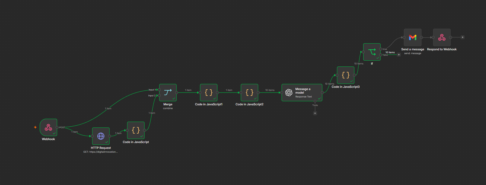

# 🚀 Santander - Assistente de Investimentos com RPA & IA Generativa

Projeto desenvolvido para o desafio final do bootcamp **Santander / DIO**, criando uma solução de automação bancária de ponta a ponta que combina **RPA em Python**, orquestração de workflows no **n8n** e geração de mensagens personalizadas com **IA Generativa (OpenAI GPT-4o)**.

---

## 📸 Evidências de Execução Ponto a Ponto

### 1. Extração RPA em Python (Google Colab)


### 2. Workflow Orquestrado no n8n


### 3. Tabela de Saída Formatada (HTML & JSON)


---

## 🛠️ Arquitetura da Solução

```mermaid
flowchart LR
    A["Página Web<br>(docs/index.html)"] -->|Web Scraping| B["RPA em Python<br>(rpa/extrair_clientes.ipynb)"]
    B -->|HTTP POST| C["Webhook n8n"]
    D["Investimentos<br>(docs/data.csv)"] -->|HTTP Request| C
    C --> E["Tratamento & Merge<br>(Code Nodes)"]
    E --> F["Agente de IA<br>(GPT-4o)"]
    F --> G["Validação & Parser<br>(Code in JavaScript3)"]
    G --> H["Filtro de E-mail<br>(If / Regex)"]
    H -->|Válidos| I["Envio de E-mail / Webhook"]